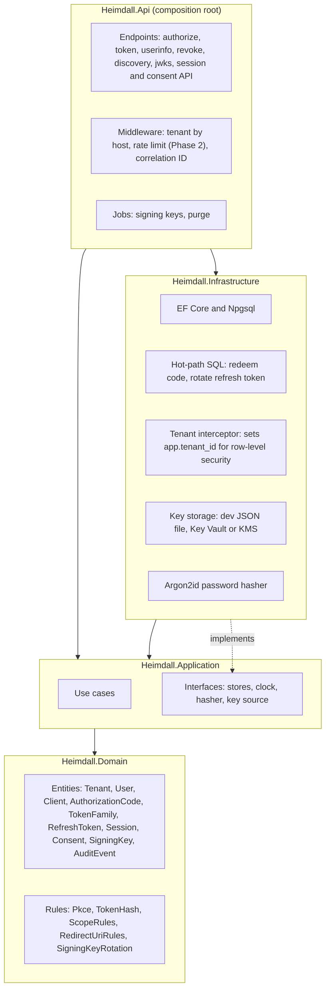
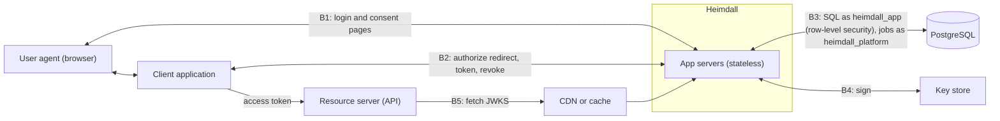
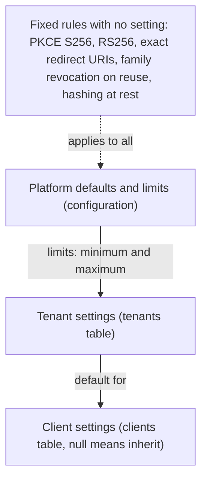

# 01 Architecture

## Layers

Dependencies point inward only. The Domain project has no outward dependency and no EF Core types.

## System context and trust boundaries

B1 to B5 match the trust boundary table in `docs/threat-model.md`.

## Settings layers (D15 to D17)

