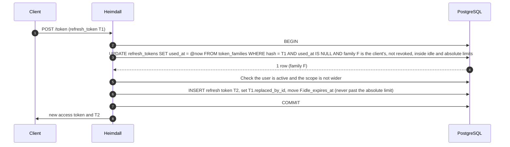
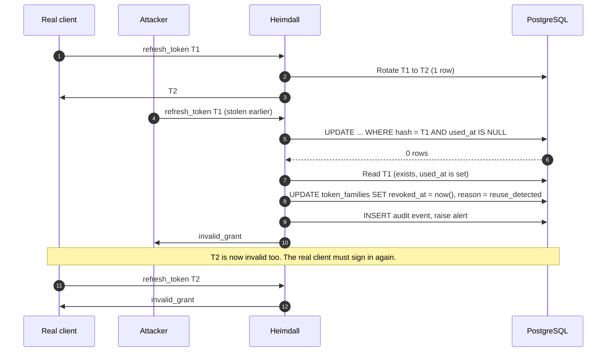
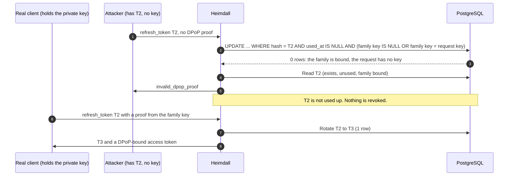
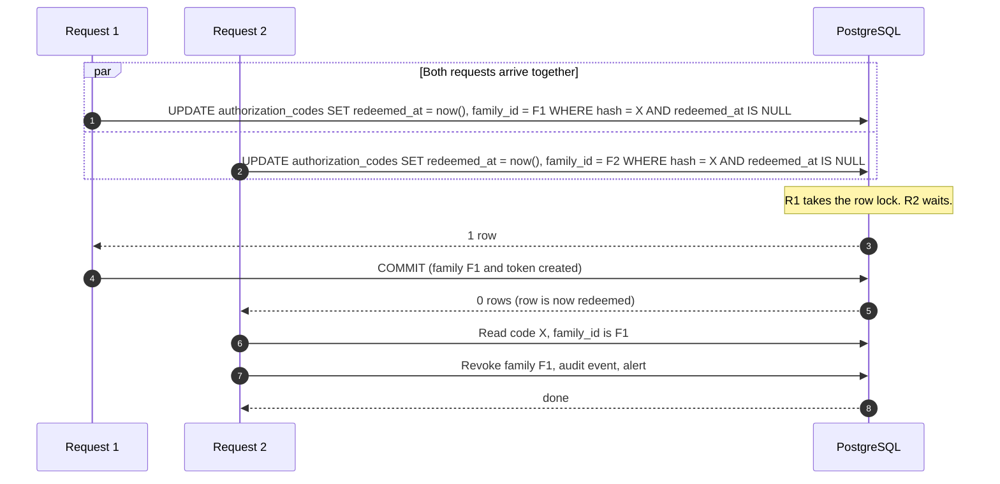
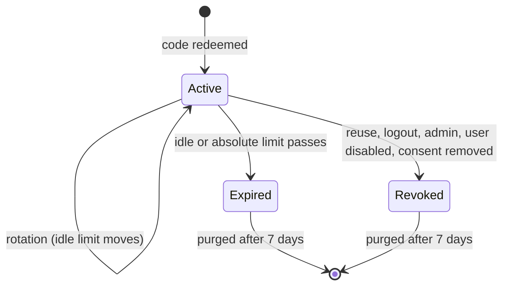
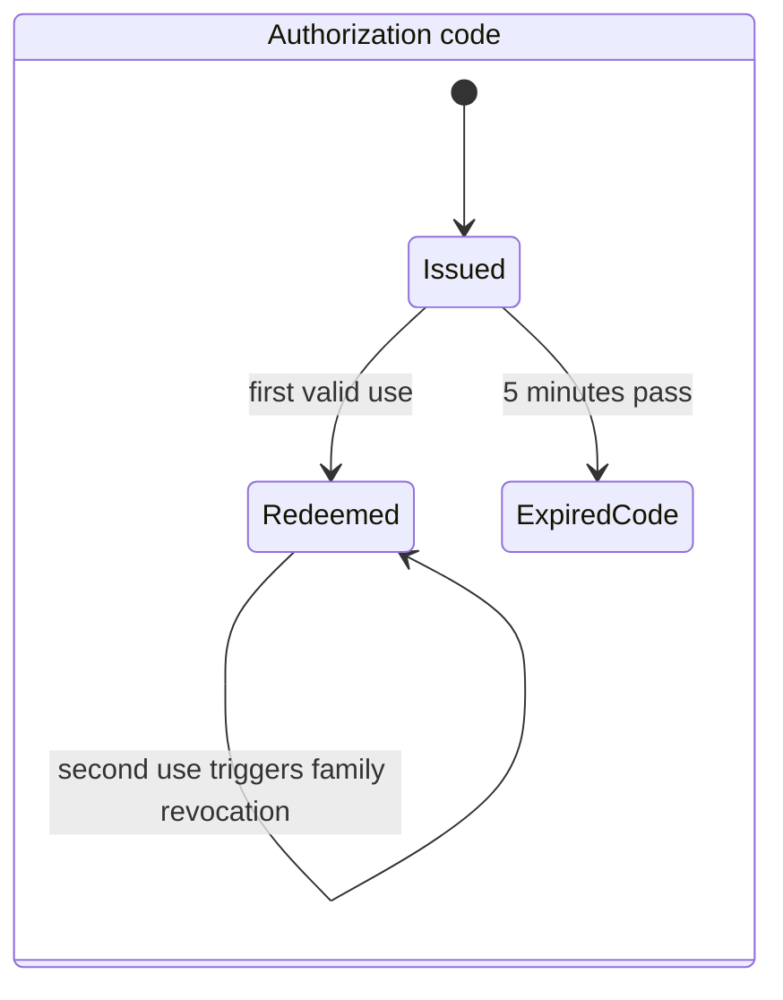
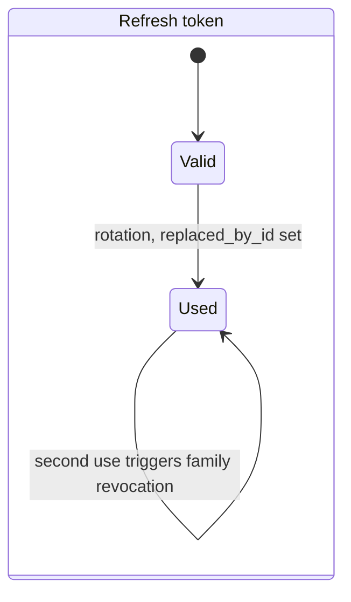

# 03 Refresh rotation and reuse detection

## Normal rotation

## Reuse of an old token (theft or retry)

There is no grace window. A client must save T2 before it uses it. See the refresh table in `docs/threat-model.md`.

## Theft of the current token from a DPoP-bound family (D24)

A proof from another key gets `invalid_grant`, and T2 stays unused too. An old, used token (T1) is reuse with or without a key, so Heimdall revokes the family as above. The thief gets no tokens either way.

## Two requests with the same code at the same time

The check and the change are one statement. No application code runs between them.

## State of a family

## State of a code and a refresh token

