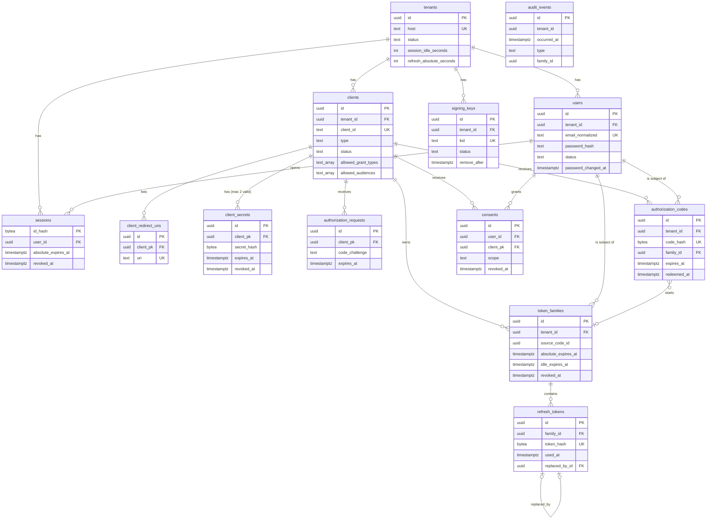

# 04 Data model

Only key columns are shown. The full design is in `docs/schema-design.md`.
Every tenant-owned table has `tenant_id`. Every unique index and foreign key includes it (D20).

`audit_events` has no foreign keys on purpose. The rows must outlive the rows they describe. The application role can only insert and select.
