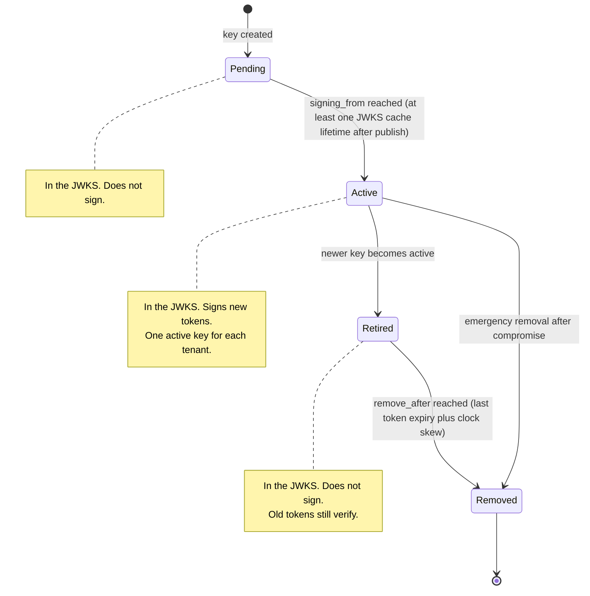
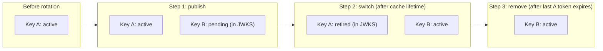
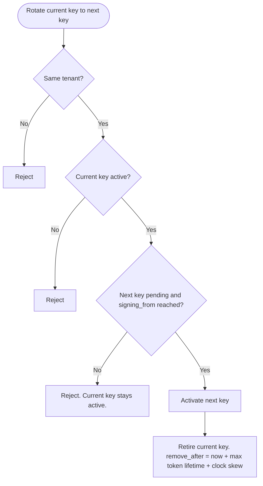
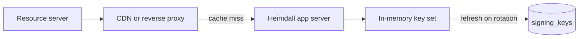
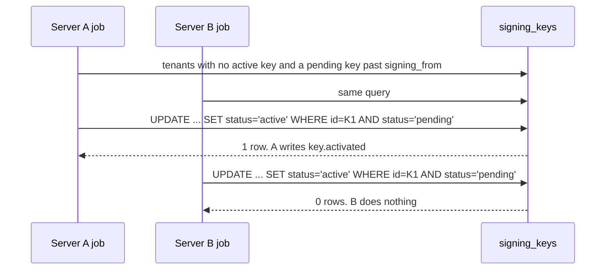
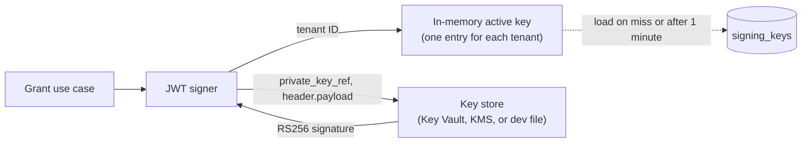

# 05 Signing keys and JWKS

## Key lifecycle

A new key is published in the JWKS before it signs anything. An old key stays in the JWKS until its last token has expired.

## Rotation over time

## Order of steps in a rotation

The next key is activated before the current key is retired. A failed rotation never leaves a tenant without a signing key.

## JWKS request path

The app server never reads the database for each JWKS request. The response has `Cache-Control: public, max-age=...` and an `ETag`. A request with a matching `If-None-Match` gets `304 Not Modified`.

A new key waits the JWKS cache lifetime plus the server key cache lifetime before it signs. A lagging server can serve the old JWKS for one server cache lifetime, and a resource server can then cache that JWKS for one JWKS cache lifetime.

## Activation job

Every server runs the job. If two servers pick different pending keys, the unique index on the active key refuses the second one.

## Token signing path

The signer builds a fixed header (`alg` = RS256, `kid`, `typ` = `at+jwt`). It sends only the bytes to sign to the key store. The private key never reaches the app server, except from the development key file.
A key change on this server clears the cache entry at once. A key change on another server reaches this server when the entry expires.
