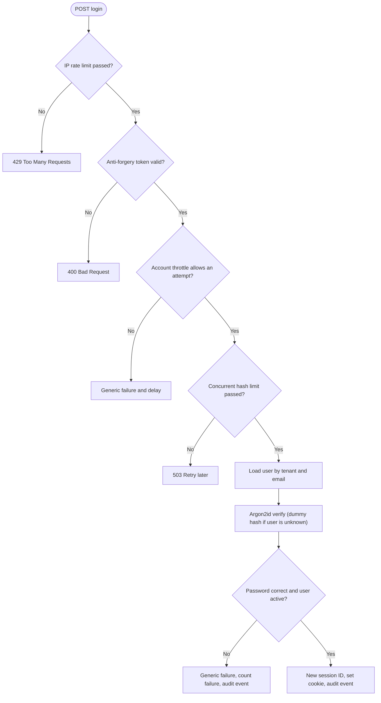
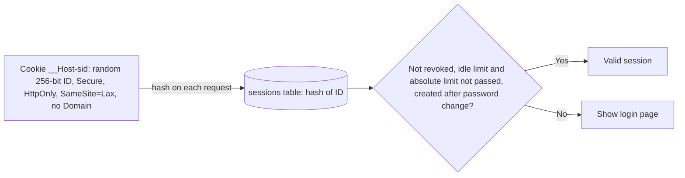
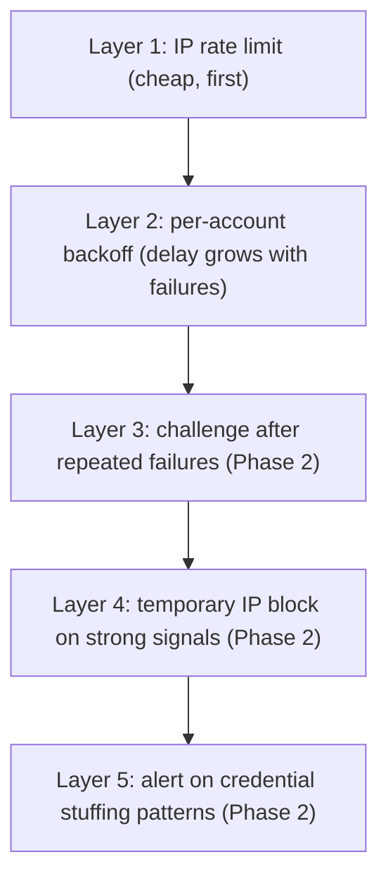

# 06 Login, session, and abuse controls

## Login request

Cheap checks run first. The expensive Argon2id hash runs last.



Failure responses and timing are the same for an unknown user and a wrong password (D5).

## Session cookie



## Abuse control layers

Throttle. Do not hard-lock accounts. A lock lets an attacker deny service to a victim.



## Consent and CSRF

```mermaid
sequenceDiagram
    autonumber
    participant B as Browser
    participant H as Heimdall
    participant DB as PostgreSQL

    B->>H: GET /authorize
    H->>DB: Store authorization request R (checked parameters)
    H->>B: 302 to /consent?request_id=R
    B->>H: GET /session/v1/consent?request_id=R
    H->>B: Client name, scopes, redirect host (from R and the client registration)
    B->>H: POST /session/v1/consent (JSON: request ID R, decision; antiforgery header; Origin)
    H->>DB: Load R, store the decision and the user on R
    B->>H: GET /oauth/v1/authorize/resume?request_id=R
    H->>DB: Decision of this user: approve inserts the code, deny deletes R
    H->>B: Redirect to redirect_uri (code, or error=access_denied)
```
