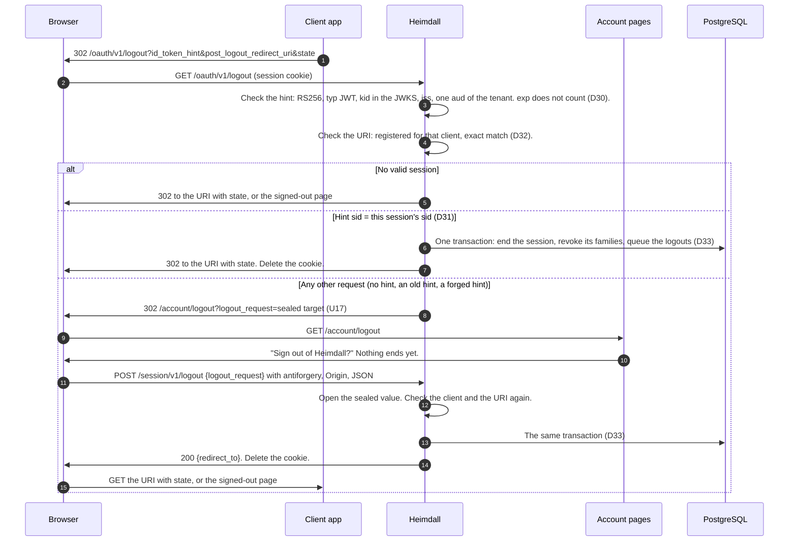
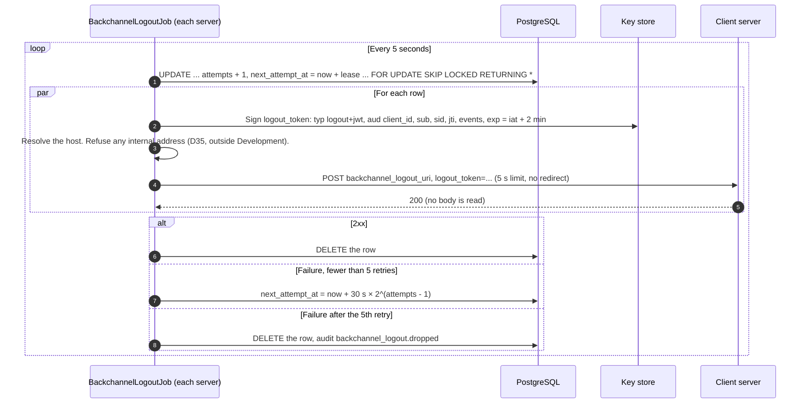
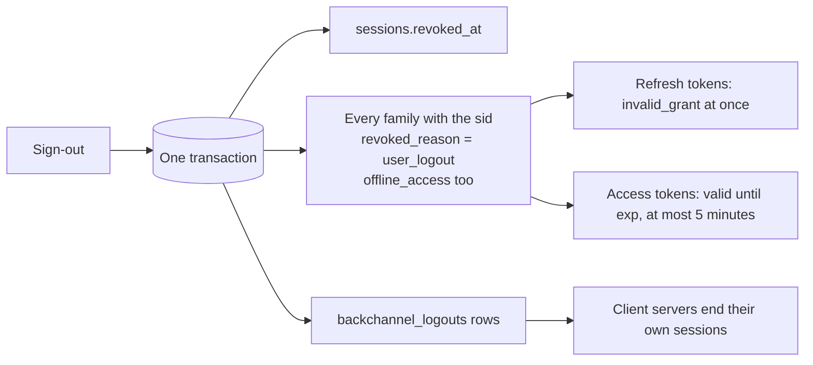

# Sign-out

The design is D29 to D35 in `docs/threat-model.md` and U17 in `docs/frontend-design.md`. The statements are in `docs/schema-design.md` ("End a session", "Deliver a back-channel logout").

## RP-initiated logout

A cross-site page can send the browser to `/oauth/v1/logout`, but it cannot get the ID token of this session. So it reaches only the confirm page (logout CSRF).

## Back-channel delivery

## What ends, and when

