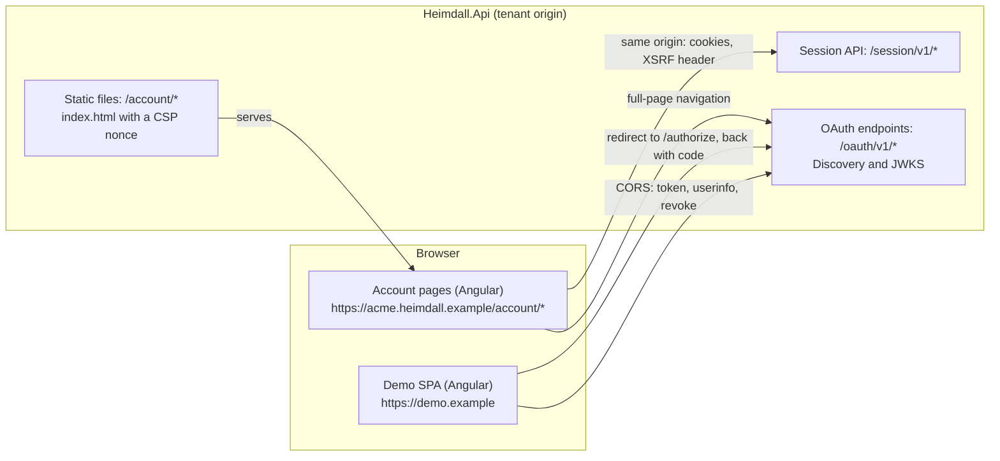
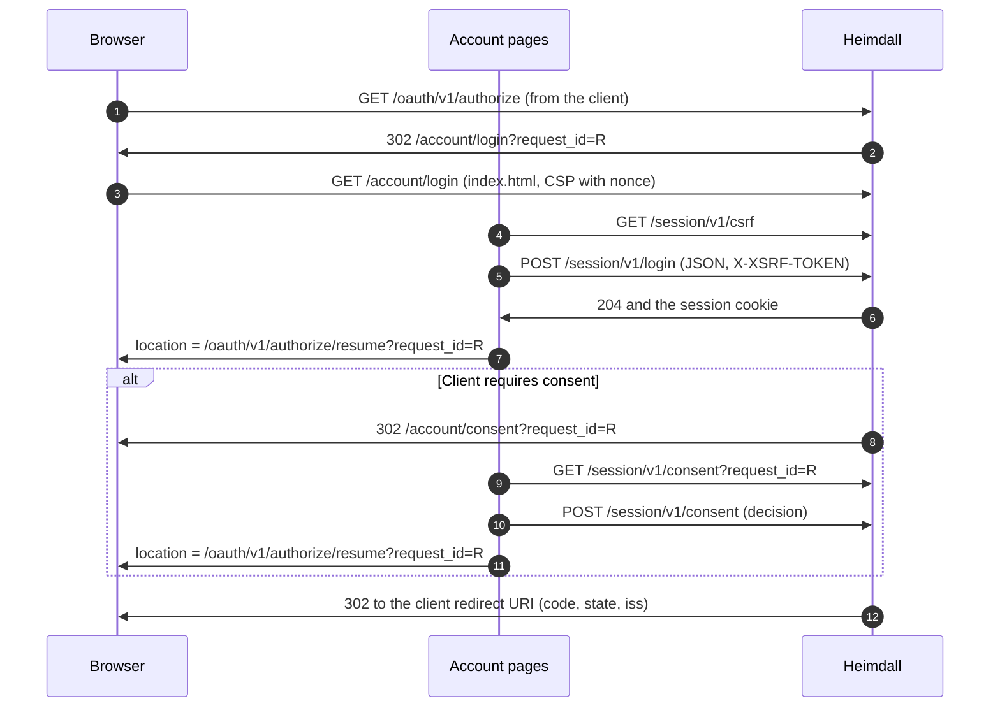
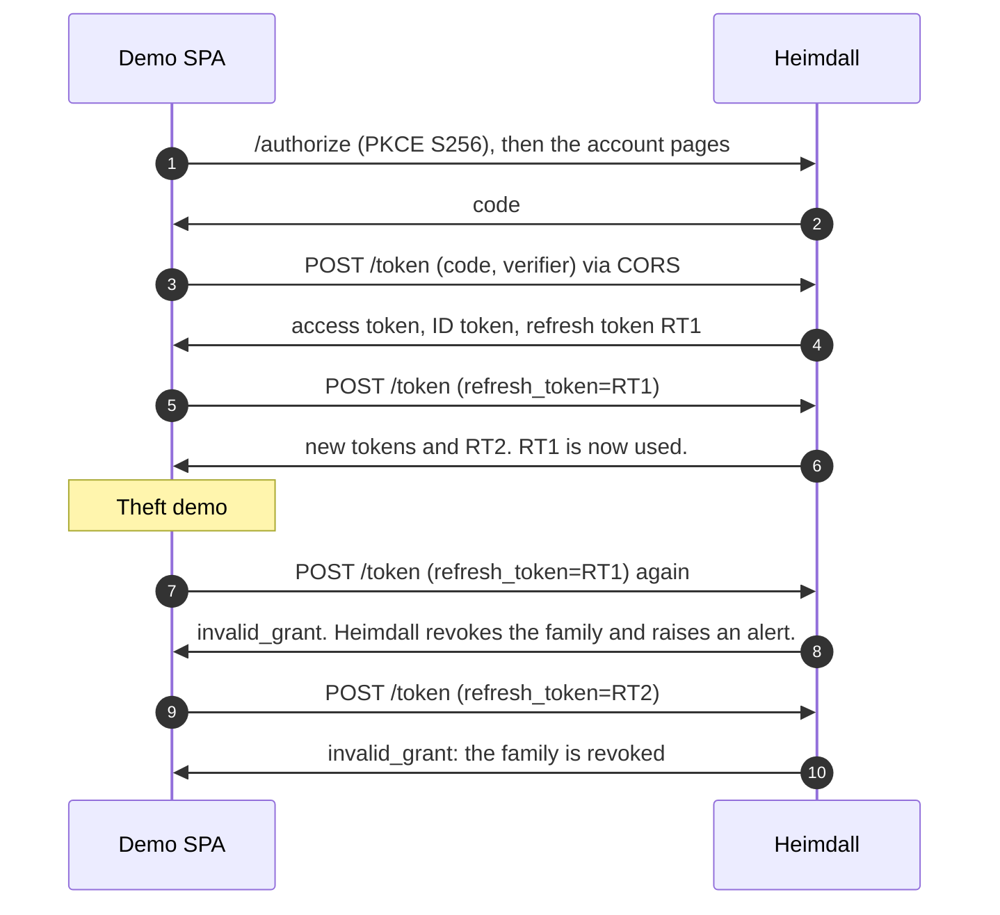

# Heimdall Front Ends: Design

Status: **Proposed** (2026-10-19). Each decision below has the ID `U1` to `U14`. A decision becomes recorded when the owner approves it. Until then, Claude asks before it builds against one.

Scope: two Angular applications.

1. **Account pages.** The login, consent, error, and signed-out pages that Heimdall shows on each tenant origin. GitHub issue #28.
2. **Demo SPA.** A sample client application on its own origin. It signs in with Heimdall and shows each security feature at work.

Out of scope: the admin portal (Phase 3). The workspace layout (U1) leaves room for it.

Writing rules are in `CLAUDE.md`. Terms are in the glossary of `docs/threat-model.md`. Product rules are in `PRODUCT.md`.

## 1. Requirements

### 1.1 Functional requirements

| ID | Requirement |
|---|---|
| F1 | A user signs in with email and password on the tenant origin. Then the browser continues the stored `/authorize` request. |
| F2 | A user approves or denies a client that requires consent. The page shows the client name, the scopes, and the redirect URI host. |
| F3 | A user sees a clear error page when Heimdall refuses an authorization request before it can redirect to the client. |
| F4 | A user signs out of Heimdall. |
| F5 | The demo SPA signs in with authorization code and PKCE, refreshes tokens, calls `/userinfo`, and signs out with `/revoke`. |
| F6 | The demo SPA shows refresh token reuse detection: it replays an old refresh token, and Heimdall revokes the family. |

### 1.2 Non-functional requirements

| ID | Requirement | Source |
|---|---|---|
| N1 | No inline script and no `'unsafe-inline'`. The pages run under a strict Content Security Policy. | `PRODUCT.md`, threat model (login, Information disclosure) |
| N2 | No page can be framed. | Threat model (login, clickjacking) |
| N3 | The account pages run on the tenant origin, because the session cookie is `__Host-` and the login API checks the `Origin` header. | D11, D21 |
| N4 | The pages reveal nothing about accounts or tenants. Copy and timing are the same for an unknown user and a wrong password. | D5, `PRODUCT.md` principle 4 |
| N5 | The pages load no code, font, or image from another origin. | Supply chain (threat model, login) |
| N6 | The login page loads fast on a slow phone connection. Target: the first form is usable after 2 seconds on a "Slow 4G" profile. Measure it; it is not a promise. | `PRODUCT.md` principle 3 |
| N7 | WCAG 2.2 level AA. | Approved, see U12 |
| N8 | Copy states only what the system enforces. | `PRODUCT.md` principle 2 |

### 1.3 Constraints

- Angular for every user interface (decided 2026-10-18).
- One developer. Learning is the goal. Time is not a constraint.
- No visual identity exists yet. Every tenant gets the same look (`PRODUCT.md`, Brand Commitments).
- The session API exists: `/session/v1/csrf`, `login`, `logout`, `me`, `consent`. Its rules do not change for the pages.

## 2. High-level design



Two applications, one rule each:

- The account pages are **first-party**. They live on the tenant origin and call the session API with the session cookie.
- The demo SPA is **third-party**. It lives on another origin and knows Heimdall only through the standard OAuth and OpenID Connect endpoints. It never calls the session API.

## 3. Decisions

### U1. One Angular workspace with separate applications

Status: **Approved** by the owner on 2026-10-19.

**Decision.** The repository gets a folder `ui/` with one Angular workspace. It holds the applications `account` and `demo`, and later `admin`. A shared library `ui-kit` holds design tokens and a few plain components.

**Reason.** One lockfile, one Angular version, and one place for supply-chain checks. Each application builds to its own bundle, so the login page never loads demo or admin code.

**Alternative.** Separate repositories. Rejected: three lockfiles to audit, and version drift between them.

### U2. Heimdall serves the account pages on each tenant origin

Status: **Approved** by the owner on 2026-10-19.

**Decision.** `Heimdall.Api` serves the built `account` application as static files under `/account/`. The routes are `/account/login`, `/account/consent`, `/account/error`, and `/account/signed-out`. `UiOptions` points `/authorize` to these paths. Every tenant gets the same files.

**Reason.** The session cookie uses the `__Host-` prefix, so only the tenant origin can set and send it (D11). The login API refuses a foreign `Origin` (threat model, CSRF row). A page on another origin cannot sign a user in.

**Alternatives.**

- A separate static host behind a reverse proxy that maps `/account/*` to it. Possible later. It adds a deployment part, and the proxy must then set the CSP and the nonce.
- Server-rendered Razor pages. Rejected: the owner decided Angular for every user interface.

### U3. A strict CSP with a nonce for each request

Status: **Approved** by the owner on 2026-10-19.

**Decision.** Heimdall serves `index.html` for the account pages itself, not as a plain static file. For each response, it creates a random nonce, puts it into `index.html` (Angular reads it from the `ngCspNonce` attribute), and sends this policy:

```
default-src 'none';
script-src 'self' 'nonce-{n}';
style-src 'self' 'nonce-{n}';
img-src 'self';
font-src 'self';
connect-src 'self';
form-action 'self';
base-uri 'none';
frame-ancestors 'none';
require-trusted-types-for 'script';
trusted-types angular angular#bundler
```

The build turns off critical CSS inlining (`inlineCritical: false`), because it adds an inline event handler that no nonce can cover. The build turns on subresource integrity (`subresourceIntegrity: true`).

`index.html` gets `Cache-Control: no-store`, because each copy has its own nonce. Hashed bundle files get `Cache-Control: public, max-age=31536000, immutable`.

The built `index.html` has no `<base>` element, because `base-uri 'none'` blocks it. The application sets `APP_BASE_HREF` to `/account/` in code instead. Each page is one level under `/account/`, so the relative bundle URLs still resolve.

**Reason.** Angular adds component styles at run time, so `style-src 'self'` alone fails, and `'unsafe-inline'` is not allowed (N1). A nonce is the strict alternative. Trusted Types stop DOM XSS at the sinks that Angular does not sanitize.

**Alternative.** Hashes of each inline part. Rejected: they change with each build, and run-time styles have no fixed hash.

### U4. The login page continues only a stored request

Status: **Approved** by the owner on 2026-10-19.

**Decision.** The login page reads `request_id` from its URL. It accepts the value only when it is a UUID. After a successful sign-in, it sends the browser to `/oauth/v1/authorize/resume?request_id={id}`. It never reads a return URL, a client, or a scope from the URL.

**Reason.** The threat model allows no free-form return URL (login, open redirect). A fixed relative path cannot point to another site.

**Login page states:**

| State | Shown to the user |
|---|---|
| Form | Email, password, "Sign in" button. The password field allows paste and password managers. |
| Wrong credentials (401 `invalid_credentials`) | "The email or the password is not correct." The same text for an unknown account and a throttled account. |
| Too many attempts (429) | "Too many attempts from this network. Try again in {n} seconds." The value comes from `Retry-After`. It is about the network, not the account, so it reveals nothing about accounts. |
| Server busy (503) | "Heimdall is busy. Try again in a few seconds." |
| No `request_id` | The page shows the signed-out text and no form. Sign-in without a client is not a supported flow yet. |

Copy never says "locked", because Heimdall never locks an account (`PRODUCT.md`, Capabilities and Constraints).

### U5. Consent shows only server values

Status: **Approved** by the owner on 2026-10-19.

**Decision.** The consent page calls `GET /session/v1/consent?request_id=...`. It shows `client_name`, `redirect_host`, and the scopes. Angular text binding encodes every value. Each known scope gets a fixed description in the page (for example, `email`: "Read your email address."). An unknown scope is shown as its raw name, in code style.

The "Allow" and "Deny" buttons send `POST /session/v1/consent` with the request ID and the decision only. Then the page sends the browser to the resume path, as in U4. `401 login_required` sends the user to the login page with the same `request_id`.

**Reason.** The browser cannot change the client or the scope (threat model, consent rows). The redirect host lets the user see where the browser goes next. A scope description is fixed text that Heimdall controls, never text from the client registration.

### U6. Error page with a fixed list of codes

Status: **Approved** by the owner on 2026-10-19.

**Decision.** `/authorize` sends a refused request to `/account/error?error={code}`, not a JSON body. The page shows text only for a fixed list of codes (`invalid_request`, `invalid_client`, `unsupported_response_type`, `temporarily_unavailable`). Any other value shows the general text. The page never prints the raw query value.

**Reason.** An error page that prints a URL value is a common phishing and injection surface. A fixed list has nothing to inject.

### U7. Same-origin API calls with Angular's XSRF support

Status: **Approved** by the owner on 2026-10-19.

**Decision.** The account application uses Angular `HttpClient` with `withXsrfConfiguration({ cookieName: '__Host-XSRF-TOKEN', headerName: 'X-XSRF-TOKEN' })`. It calls `GET /session/v1/csrf` once when it starts. It uses relative URLs only.

**Reason.** This is the double-submit pattern that the login API already checks (threat model, CSRF row). Angular sends the header only to relative URLs, so it never leaks the token to another origin.

The typed API client comes from the OpenAPI document of the session API (issue #22).

### U8. Supply-chain controls for the Angular build

Status: **Approved** by the owner on 2026-10-19.

**Decision.**

- `package-lock.json` is committed. CI installs with `npm ci --ignore-scripts`. A package that needs an install script gets a reviewed exception.
- CI runs `npm audit --audit-level=low` and fails on a finding. Dependabot watches `ui/`.
- Dependency review (already in CI) covers `ui/` pull requests.
- Few dependencies. The account pages use Angular and the Angular CDK only. No component library and no CSS framework.
- No third-party origin in the CSP (N5). Changed on 2026-10-23 with the owner's approval (U15): the pages may use font files that Heimdall serves from its own origin (`font-src 'self'`). The files are in the repository, not in an npm package. They are never loaded from a font service.

**Reason.** A compromised package in the login page can read every password (threat model, login, supply chain row). Fewer packages mean less to trust. Install scripts are the most common way a malicious package runs code.

### U9. The demo SPA is a public client on its own origin

Status: **Approved** by the owner on 2026-10-19.

**Decision.** The demo SPA runs on its own origin (development: `https://demo.localhost:4300`). It is registered as a public client with authorization code, PKCE (S256), refresh tokens, and no registered audience. Its access tokens are therefore for `/userinfo` (D22).

It uses `angular-auth-oidc-client`, an OpenID-certified relying party library. It does not use hand-written OAuth code.

**Reason.** A certified library that works against Heimdall is interop evidence (issue #21). Hand-written client code would only prove that Heimdall agrees with itself.

### U10. The demo SPA keeps tokens in memory only

Status: **Approved** by the owner on 2026-10-19.

**Decision.** The demo SPA stores tokens in memory, not in `localStorage` or `sessionStorage`. After a page reload, it sends the browser to `/authorize` again. The Heimdall session cookie is still valid, so Heimdall returns a code at once, with no page. The demo SPA does not use silent renew in a hidden iframe.

**Reason.** Script on the page can read web storage, so an XSS bug there would leak the refresh token. Memory is lost on reload, which is safer. A hidden iframe cannot work, because Heimdall pages send `frame-ancestors 'none'` (N2).

**Trade-off.** A reload costs one redirect. That is acceptable for a demo.

**What goes to `sessionStorage`.** Memory is empty when the browser comes back to `/callback`, so some values must live through the redirect. The demo keeps an allowlist of library keys there: `state`, `nonce`, `code_verifier`, and two flags of the sign-in request. The library removes them after the callback. The list also holds the discovery document (`authWellKnownEndPoints`), which is public: the library reads the token endpoint from it at `/callback`. A key that is not on the list stays in memory, so a new token key in a later library version never lands in web storage. One more flag, `heimdall-demo.resume`, holds no token. It tells a reloaded page to go to `/authorize` again. The page removes it before the redirect, so an error response cannot start a loop.

**Why the verifier may sit in `sessionStorage`.** The `code_verifier` is useful only with the one code that comes back to the redirect URI. Script that can read `sessionStorage` on this origin can also read that code from the URL, so memory would not protect it. A refresh token is different: it lives for hours and works without the browser.

**Alternative.** A backend-for-frontend (BFF), which keeps tokens on a server and gives the browser only a cookie. This is the most secure pattern for browser apps (IETF draft "OAuth 2.0 for Browser-Based Applications"). It is a candidate for a second demo. The first demo stays a pure SPA, because it exercises the public-client features of Heimdall: PKCE, rotation, and reuse detection.

### U11. Demo SPA screens

Status: **Approved** by the owner on 2026-10-19.

| Screen | Shows |
|---|---|
| Signed out | "Sign in with Heimdall" button. |
| Signed in | ID token claims, decoded, with the note "The library verified the signature." The access token expiry, as a countdown. |
| User info | The response of `/userinfo`, with the scopes that released each claim. |
| Refresh | A "Refresh now" button. The page shows that the refresh token changed (the first 6 characters of a SHA-256 of each token, never the token). |
| Theft demo | A "Replay the old refresh token" button. It sends the previous refresh token to `/token`. The page shows `invalid_grant`, then shows that the current refresh token also fails: Heimdall revoked the whole family. |
| Sign out | Revokes the refresh token (`/revoke`), then clears memory. The page says that the Heimdall session stays until RP-initiated logout exists (U14). |

The theft demo is the strongest portfolio screen. It shows refresh token reuse detection at work, in a real browser, with no grace window.

### U12. Accessibility: WCAG 2.2 level AA

Status: **Approved** by the owner on 2026-10-19.

**Decision.** Both applications meet WCAG 2.2 level AA. Each form field has a visible label. Errors are announced with `aria-live`. Focus moves to the first error. Every action works with a keyboard. Color contrast is at least 4.5:1 for text.

**Reason.** `PRODUCT.md` listed the accessibility standard as an open item. AA is the common legal and industry baseline. A login page that a screen reader cannot use locks real users out.

### U13. Visual direction (superseded by U15)

Status: **Superseded** on 2026-10-23 by U15. Claude decided U13 on 2026-10-19, when the owner delegated the visual design. The text stays here as a record. The demo SPA keeps this look in `ui/projects/demo/src/client-kit.css`.

**Decision.** The pages follow a public-service identity program, like a government design system. A lapis band runs across the top with the word "Heimdall". The origin plate hangs from the band and shows the tenant host, for example "Signing in to acme.localhost:7200". The page is white, with a left-aligned column. Controls are square, with a 2px border and a height of 48px. Keyboard focus is a yellow field. The system font stack is used (U8). Light and dark themes come from `prefers-color-scheme`.

Each state color has one meaning: lapis for Heimdall and its actions, red for a refusal, green for a confirmation, yellow for focus only. No card, box, or shadow ranks content; size and weight do.

The tokens and the frame component are in `ui/projects/ui-kit`. Tenant branding (Phase 3) changes tokens, not components. The demo SPA uses the same kit with a neutral band labeled "Demo client", so the user can see that it is a different site.

**Reason.** The host is already in the address bar, so the plate reveals nothing new. It helps the user compare the two and see a phishing copy. A plain public-service look loads fast, works without a web font, and states only facts.

### U15. Visual direction: Burning Bridge

Status: **Approved** by the owner on 2026-10-23. The owner drew the direction with Claude in Figma ("Heimdall · Burning Bridge"). The owner asked the build to go further than the Figma frames. The direction contract is in `.impeccable/surfaces/ui-projects-account.md`.

**Decision.**

- In the myths, Heimdall guards Bifröst, the burning bridge to Asgard. Each account page is the gate at the foot of the bridge.
- The page has three parts. A large statement is on the left, for example "Sign in." The gatehouse panel on the right holds the task. The gate plaque at the bottom left shows the tenant host. On a phone, the parts stack in this order: statement, plaque, panel.
- The plaque says "Check that your address bar shows the same host." The host is in a monospace font.
- The bridge is an arc of frost bands behind the panel. The bridge shows the state of the request:

| State | When | What the bridge does |
|---|---|---|
| `idle` | Nothing is in progress. | Stars twinkle. Soft lights move slowly along the bands. The bands show the progress (see below). |
| `busy` | Heimdall checks the password or loads a request. | Fast lights move up every band, one after the other. |
| `refused` | Heimdall refuses (wrong credentials, throttle, error page), or the user selects Deny. | Every band turns red, and the outer band flares and burns. |
| `crossing` | Sign-in or Allow succeeded. The browser is about to leave. | Every band lights from the gate to the sky. |

- The page has short moments, taken from the owner's motion prototype ("Burning Bridge Motion"). On load, the bands draw in from the ground, the statement rises, and its full stop ignites. At rest, embers crawl along the thin ember line and the guard band flickers. A wrong password flares the guard band and shakes the panel once. The error page drops "Gate shut." in letter by letter. A busy button carries a running line. The form never waits on a moment.
- Changed on 2026-10-23 at the owner's request: the bands show progress. Each band is unlit (dim frost) until the crossing reaches it. The login page lights no band. The consent page lights the two inner bands, because the password step is behind the user. A crossing lights all four. A band lights for a step that the user completed, never for a fact about the account. For example, a future email step (identifier-first) lights a band for every email, so the bridge cannot show whether an account exists.
- The password field has an eye toggle inside the field, named "Show password", with `aria-pressed` as its state.
- A "Motion" switch stops all movement. Its default follows `prefers-reduced-motion`. The browser keeps the user's choice in `localStorage`. When storage fails, the page works without it. With motion off, the state colors stay.
- Each color has one meaning. Frost blue is the bridge and Heimdall's actions. Ember orange is the bridge's fire at rest and keyboard focus. Red is a refusal only.
- Night and day themes come from `prefers-color-scheme`. In forced-colors mode (Windows High Contrast), the bridge is hidden and every control keeps a system-color border.
- Fonts: Archivo (display and text) and JetBrains Mono (hosts, codes, scope names). Both are under the SIL Open Font License 1.1. The `woff2` files are in `ui/projects/ui-kit/fonts/`. Heimdall serves them from its own origin, with a one-year cache (U8).
- Controls are square and 56px tall. The primary button says "Sign in". The consent page labels each scope with the scope name that the app asked for, for example `openid`.
- The bridge is decoration with a job. It is hidden from assistive technology, because the text on the page says the same state.
- The demo SPA is a client, not Heimdall. It does not use this look. It keeps the U13 look in its own stylesheet, so a user can see that it is a different site.

**Reason.**

- The plaque does what the U13 origin plate did. The host is already in the address bar, so the plaque reveals nothing new. It helps the user compare the two and see a phishing copy.
- The bridge makes each state visible at a distance, but no state depends on it. Text, focus, and `aria-live` still carry every state (U12).
- Red means only "refused", so a user learns that red fire means "Heimdall said no".
- Self-hosted fonts add no third-party origin to the CSP. The two files are about 130 KB. The browser caches them for a year, because each file name has a content hash.

### U14. Later work that these pages need

These items are not part of the first build. They are listed so that no page claims them:

- RP-initiated logout (OpenID Connect `end_session_endpoint`, issue #40). Until then, "Sign out" in a client ends only the client's tokens.
- An account picker for `prompt=select_account` (issue #41). It needs a session model with several accounts first.
- A tenant display name. The pages show the host only, because no API returns a display name yet.
- Registration, email verification, and password reset (threat model, out of scope). The login page has no "Forgot password" link until they exist. A link to a missing feature would break principle N8.

## 4. Flows

### 4.1 Sign-in and consent



### 4.2 Demo SPA and the theft demo



## 5. Server changes that the pages need

| # | Change | Note |
|---|---|---|
| S1 | Done. Serve `/account/*` from `wwwroot/account`, with the nonce in `index.html` and the CSP of U3 on these paths only. | Other paths keep `default-src 'none'`. |
| S2 | Done. `UiOptions`: `LoginPath = /account/login`, `ConsentPath = /account/consent`. | Configuration only. |
| S3 | Done. `/authorize` error page: redirect to `/account/error?error={code}`. | Replaces the JSON body (U6). |
| S4 | Done (D23). CORS for registered client origins on `/token`, `/revoke`, and `/userinfo`. The allowed origins are the origins of the client's redirect URIs. Never `*`. Discovery and JWKS allow any origin, because they are public. | Threat model, `/userinfo` CORS row. Needs its own threat model rows. |
| S5 | OpenAPI document for `/session/v1` (issue #22). | For the typed client (U7). |
| S6 | Done. `seed-dev` registers the demo SPA client. | Public client, redirect URI `https://demo.localhost:4300/callback`. |

## 6. Testing

| Level | Tool | What it proves |
|---|---|---|
| Unit and component | Vitest with Angular TestBed | Form states, error texts, the UUID check on `request_id`, the fixed error-code list. |
| End to end | Playwright against a running Heimdall (PostgreSQL in a container) | The full flow of 4.1 and 4.2 in Chromium, Firefox, and WebKit. |
| CSP | Playwright | The test listens for `securitypolicyviolation` events. Any event fails the test. |
| Accessibility | axe-core in Playwright | No WCAG 2.2 AA violation on each page state. |
| Security headers | Integration test in .NET | CSP, nonce change on each request, `no-store` on `index.html`, immutable bundles. |
| Interop | The demo SPA flow in Playwright | A certified library signs in, refreshes, and revokes (issue #21). |

## 7. Build and local development

- `ui/` builds with the Angular CLI. The .NET build does not build Angular.
- Development: `ng build account --watch` writes to `src/Heimdall.Api/wwwroot/account/`, which git ignores. Heimdall serves it on `https://acme.localhost:7200/account/`, so the pages run on the real tenant origin with the real cookies and CSP.
- The demo SPA runs with `ng serve demo` on `https://demo.localhost:4300`. It is a separate origin by design.
- Node.js: the Angular CLI needs 22.22.3 or later, or 24.15.0 or later. `ui/.nvmrc` names 24, and CI reads it.
- CI: a new job installs, audits, lints, tests, and builds `ui/`, then runs the Playwright tests against Heimdall.
- Release: a container build copies the `account` bundle into `wwwroot`. The deployment work in Phase 4 decides the image.

## 8. Threat model changes

These rows go into `docs/threat-model.md` when the owner approves this design:

| STRIDE | Threat | Mitigation |
|---|---|---|
| Tampering | XSS in an account page runs attacker script. | Angular encodes every bound value. The CSP allows only same-origin script with a nonce for each request. Trusted Types block the DOM sinks that Angular does not sanitize (U3). |
| Tampering | A changed bundle file on the server or a cache. | Subresource integrity on each script (U3). |
| Spoofing | A phishing copy of the login page on another origin. | It cannot set or send the `__Host-` cookie, and the login API refuses its `Origin`. The page shows the tenant host on the gate plaque (U15). |
| Information disclosure | The error page prints an attacker's value from the URL. | The page shows text for a fixed list of codes only (U6). |
| Elevation of privilege | A malicious npm package runs in the login page. | Lockfile, `npm ci --ignore-scripts`, audit in CI, few dependencies, no third-party origins (U8). |
| Information disclosure | XSS in the demo SPA reads stored tokens. | Tokens are in memory only (U10). |
| Information disclosure | CORS lets another site read `/userinfo` or `/token` responses. | Only the origins of a client's registered redirect URIs. Never `*` (S4). |

## 9. Open questions for the owner

1. Approve U14, or change it. U1 to U12 and U15 are approved. U15 replaced U13 on 2026-10-23.
2. Decided on 2026-10-19: the demo SPA uses `angular-auth-oidc-client` (U9).
3. Build a BFF demo later (U10, alternative)?
4. Decided on 2026-10-19: the account pages and the demo SPA are built in parallel. The demo SPA cannot finish a sign-in until S1 to S4 exist.

## 10. What to revisit as Heimdall grows

- Tenant branding (Phase 3): tokens in `ui-kit` change; components do not.
- The admin portal: a third application in the same workspace, on a platform origin, with its own CSP.
- WebAuthn and passkeys (Phase 3): new states on the login page.
- If static hosting moves to a CDN, the nonce must come from an edge function or move to hashes.
